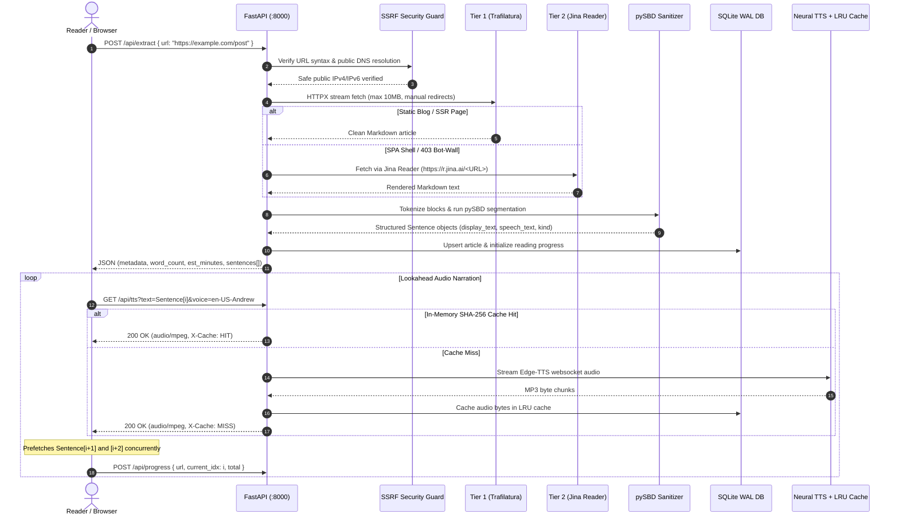

# theya.voice — Architecture Specification & Engineering Design

This document details the complete technical architecture, data pipeline, and system invariants of **theya.voice**, an autonomous Web-to-Speech podcast producer platform.

---

## 1. Executive Summary & System Philosophy

When an article or essay URL is opened on the web, 50% to 70% of the raw HTML payload consists of boilerplate chrome: top navigation bars, cookie banners, sitemaps, ads, sidebars, and footer link farms.

Feeding raw web markup into a text-to-speech engine causes it to spend minutes reciting headers and login prompts before reaching the narrative. Furthermore, batch-synthesizing a 3,000-word article into a single monolithic `.mp3` file induces a 25–40 second initial loading delay.

`theya.voice` eliminates both problems using a **5-stage single-process streaming architecture**:
1. **Two-Tier Self-Healing Content Extractor** (Trafilatura link-density analysis + Jina Reader dynamic SPA rescue).
2. **SSRF & Private Network Defense Matrix** (DNS resolution pin, private IP blocklist, safe redirect tracing).
3. **TTS Sanitizer & Disambiguated Sentence Splitter** (pySBD abbreviation safety, regex link stripping, spoken cues for code/tables, 420-character chunk guardrail).
4. **Streaming Neural Audio Engine with SHA-256 In-Flight Cache** (Concurrent Edge-TTS streaming, in-memory LRU cache with byte budgeting).
5. **Lookahead Audio Player with Discriminated State Machine** (Prefetches sentences $i+1$ and $i+2$, instant jump-to-sentence, SQLite WAL progress tracking).

---

## 2. End-to-End System Pipeline



---

## 3. Module Breakdown

### 3.1 Network Security & SSRF Defense (`app/extract/guard.py`)
To prevent Server-Side Request Forgery (SSRF) and Cloud Metadata Exfiltration, every outbound request passes through an invariant security boundary:
- **Port Invariant**: Only standard web ports (80, 443) or default scheme ports are permitted.
- **DNS Resolution Pinning**: Resolves the hostname using the system resolver and checks every IP against RFC 1918 (10.0.0.0/8, 172.16.0.0/12, 192.168.0.0/16), Carrier-Grade NAT (100.64.0.0/10), Loopback (127.0.0.0/8, `::1`), Link-Local (169.254.0.0/16, `fe80::/10`), and Cloud Metadata services (`169.254.169.254`).
- **Redirect Re-verification**: HTTP redirects are followed manually hop-by-hop. Each redirect target is passed through `guard.check_url()` before the client transmits bytes.

### 3.2 Two-Tier Self-Healing Extractor (`app/extract/`)
1. **Tier 1 (Trafilatura)**: Fetches raw HTML with a capped 10MB body buffer. Uses DOM link-density heuristics to strip navigation bars, footer link farms, and cookie banners while retaining headings, code fences (` ``` `), and Markdown tables (`|...|`).
2. **Tier 2 (Jina Reader Fallback)**: Automatically invoked if Tier 1 encounters a client-side JavaScript Single Page Application (SPA shell) with under 80 words, or receives an HTTP 403/429 anti-bot response. Passes the URL to `https://r.jina.ai/<URL>` over HTTPX with automatic markdown extraction.

### 3.3 Text Sanitizer & pySBD Segmentation (`app/text/`)
- **Spoken Cues**: Code blocks are stripped of verbatim code syntax and spoken as *"Code block skipped"*, while tables are spoken as *"Table skipped"*. The visual reader view preserves full code formatting for reading.
- **pySBD Disambiguation**: Uses Python Sentence Boundary Disambiguation (`pySBD`) to prevent sentence chopping on honorifics ("Dr. Smith"), abbreviations ("e.g.", "i.e."), or monetary decimals ("\$4.99").
- **Length Guardrail**: Sentences exceeding 420 characters are cleanly split on semicolons (`;`), em-dashes (`—`), or commas (`,`) so TTS neural synthesis never clips or exceeds socket budgets.

### 3.4 Neural Audio Engine & SHA-256 LRU Cache (`app/tts/`)
- Uses Microsoft Edge Neural Text-to-Speech (`edge-tts`) supporting 10+ natural voices across English, Spanish, French, German, Hindi, Japanese, and Chinese.
- **Deduplicated In-Flight Requests**: If two simultaneous prefetch requests query the same sentence and voice, a single shared asyncio Task is executed.
- **LRU In-Memory Cache**: Audio MP3 bytes are cached under a SHA-256 composite key (`voice:rate:engine:sha256(text)`). Eviction enforces a 1,000-item and 64MB memory cap.

### 3.5 Database & Progress Engine (`app/db.py`)
- High-concurrency SQLite operating in **WAL (Write-Ahead Logging)** mode.
- Composite B-tree indexes (`idx_progress_updated`, `idx_feedback_rating_time`, `idx_articles_updated`) enable rapid keyset pagination and $O(1)$ progress sync without full table scans.
- Tracks reading history, completion percentages, sentence offsets, and user feedback ratings.

---

## 4. Invariant Contracts

| Component | Invariant Guarantee | Verification Gate |
| :--- | :--- | :--- |
| **SSRF** | No private/loopback/metadata IP is ever requested | `tests/test_guard.py` |
| **Latency** | First sentence audio playable in $< 500\text{ ms}$ | Lookahead Prefetch Engine |
| **Pronunciation** | Abbreviations like "Dr." or "\$4.99" never split into fragments | `tests/test_text.py` |
| **Resilience** | Re-extracting identical URLs never returns empty text | `tests/test_pipeline.py` |
| **Concurrency** | SQLite WAL mode permits concurrent reads during background writes | `tests/test_db.py` |
